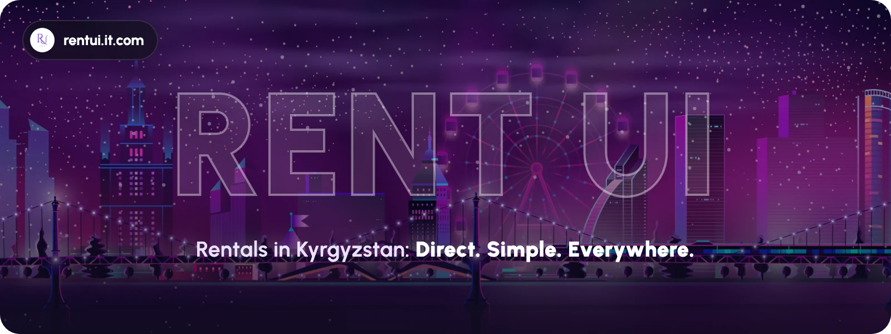
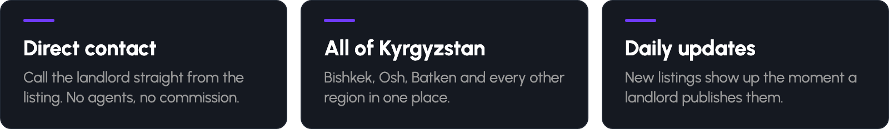
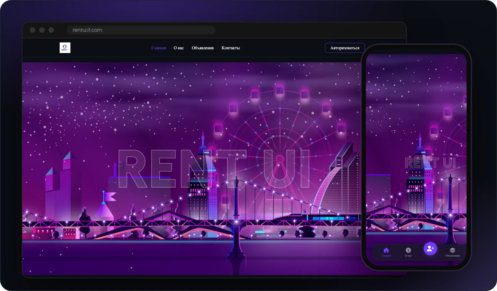
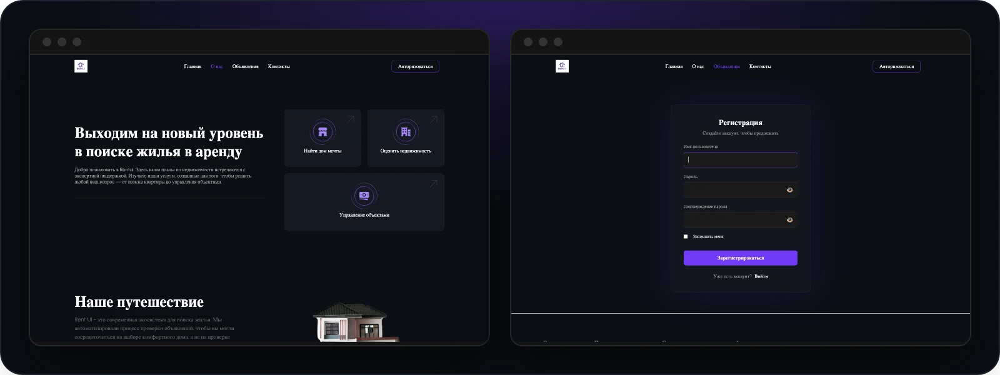

<p align="center"><b>English</b> &nbsp;|&nbsp; <a href="README.ru.md">Русский</a></p>

<p align="center">
  <a href="https://www.rentui.it.com">
    
  </a>
</p>

<p align="center">
  <a href="https://www.rentui.it.com"></a>
  
  
  <a href="LICENSE"></a>
</p>

<p align="center">
  <b>Rent Ui</b> is a website with rental listings in Kyrgyzstan.<br>
  Owners post flats and houses. People who need a home find them and call the owner directly — no agents and no fees.
</p>

<p align="center">
  
</p>

## Preview

<p align="center">
  
</p>

<p align="center">
  
</p>

## Features

- **Accounts.** Sign up, log in, log out. After you log in, you go back to the page you came from.
- **Listings.** Title, description, price in som, address, phone number and photos.
- **Photo gallery.** The first photo becomes the cover, the other photos go to the gallery. Only images up to 5 MB are allowed.
- **Owner rights.** Only the author or an admin can edit or delete a listing.
- **Search.** By title and description, with pages.
- **Clean storage.** Photos are kept in DigitalOcean Spaces and are deleted together with the listing.
- **Mobile layout.** Pages fit any screen, and phones get a tab bar at the bottom.
- **Admin panel.** Django admin where you can see the photo gallery inside the listing.

## Tech stack

<p>
  
  
  
  
  
</p>

| Part | Technology |
|---|---|
| Backend | Python 3.12, Django 5.0 |
| Database | PostgreSQL on Neon, or any database through `DATABASE_URL` |
| Photos | DigitalOcean Spaces through django-storages and boto3 |
| Static files | WhiteNoise |
| Hosting | Vercel |
| Frontend | Django templates, plain CSS, Font Awesome |

## Quick start

```bash
git clone https://github.com/a1tvv/rentui.kg.git && cd rentui.kg
python3 -m venv .venv && source .venv/bin/activate
pip install -r requirements.txt

cp .env.example .env
python -c "from django.core.management.utils import get_random_secret_key as g; print(g())"
# paste the printed key into SECRET_KEY in .env

python manage.py migrate
python manage.py runserver
```

Then open http://127.0.0.1:8000.

## Configuration

On your computer, the settings come from `.env`. In production, they come from environment variables (see [`.env.example`](.env.example)).

| Variable | What it is |
|---|---|
| `SECRET_KEY` | Django secret key |
| `DEBUG` | `True` for local development. Do not set it in production |
| `DATABASE_URL` | `sqlite:///db.sqlite3` on your computer, a PostgreSQL URL in production |
| `AWS_ACCESS_KEY_ID`, `AWS_SECRET_ACCESS_KEY` | DigitalOcean Spaces keys for photos. The site needs them to start |
| `EMAIL_HOST_USER`, `EMAIL_HOST_PASSWORD` | Gmail address and app password for the contact form |

## Tests

```bash
python manage.py test
```

Tests use the database from `DATABASE_URL`, so keep it on SQLite on your computer. Uploaded files stay in memory and are never sent to Spaces.

## Deploy

The site runs on Vercel ([`vercel.json`](vercel.json)). In **Project → Settings → Environment Variables** add every variable from the table above, except `DEBUG`. If you add a new domain, also add it to `ALLOWED_HOSTS` and `CSRF_TRUSTED_ORIGINS` in [`config/settings.py`](config/settings.py).

## Project structure

```
rentui.kg/
├── anons/         # listings, photos, sign up and log in
├── main/          # home, about, services and contact pages
├── config/        # settings and URLs
├── templates/     # Django templates
├── static/        # CSS and images
└── images/        # pictures for this README
```

---

<p align="center">
  <br><br>
  Made in Kyrgyzstan by the <b>Fidea</b> team
</p>

<p align="center">
  <a href="https://www.instagram.com/fidea.312/"></a>
  <a href="https://t.me/fidea_kg"></a>
  <a href="https://wa.me/+996999888615"></a>
</p>

<p align="center"><sub>Released under the <a href="LICENSE">MIT License</a></sub></p>
