<!-- Этот файл собирается автоматически: python3 scripts/readme.py. Правки вручную перезапишутся. -->
<p align="center"><a href="README.md">English</a> &nbsp;|&nbsp; <b>Русский</b></p>

<a href="https://www.rentui.it.com"></a>

<p align="center">
  <a href="#features">Возможности&nbsp;›</a>&emsp;
  <a href="#screens">Экраны&nbsp;›</a>&emsp;
  <a href="#stack">Стек&nbsp;›</a>&emsp;
  <a href="#run">Запуск&nbsp;›</a>&emsp;
  <a href="#settings">Настройки&nbsp;›</a>&emsp;
  <a href="#structure">Структура&nbsp;›</a>
</p>

<br>

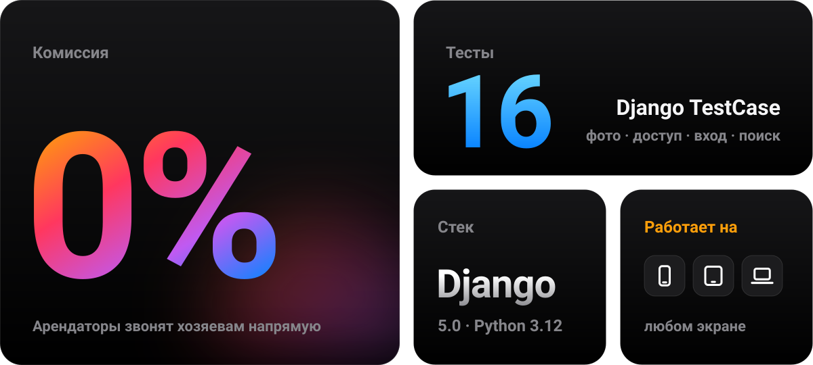

<br>
<br>

<p align="center">
  <i>“Simplicity is the ultimate sophistication.”</i><br>
  <sub>— брошюра Apple II, 1977</sub>
</p>

<br>

<a name="features"></a>


<a href="anons/models.py">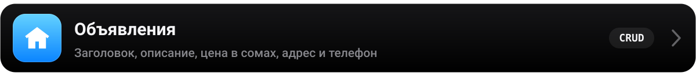</a>
<a href="anons/forms.py">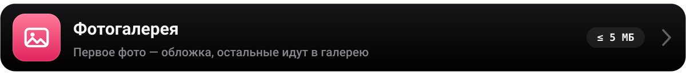</a>
<a href="anons/views.py">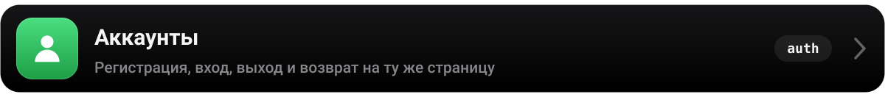</a>
<a href="anons/views.py">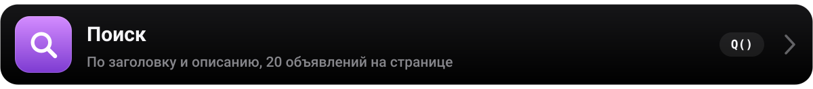</a>
<a href="anons/views.py"></a>
<a href="anons/models.py">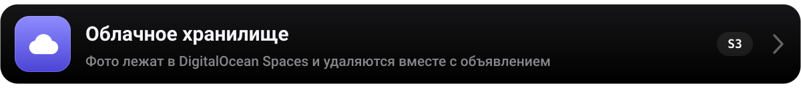</a>

<br>
<br>

<a name="screens"></a>


<a href="https://www.rentui.it.com">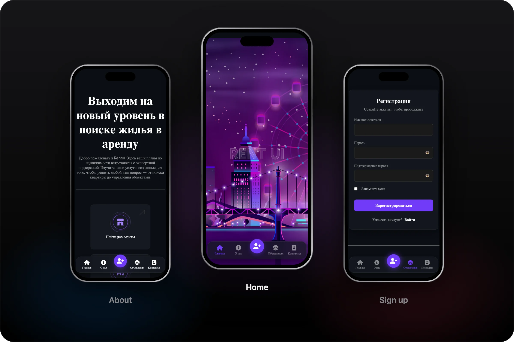</a>

<br>
<br>

<a name="stack"></a>


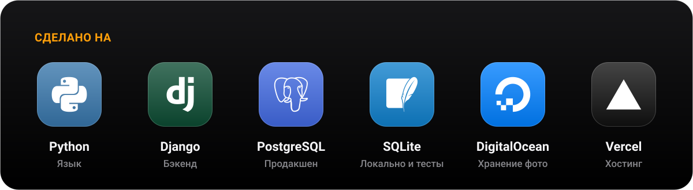

<br>
<br>

<a name="run"></a>


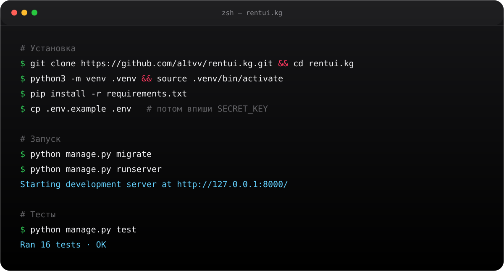

<details>
<summary>Скопировать команды</summary>
<br>

```bash
git clone https://github.com/a1tvv/rentui.kg.git && cd rentui.kg
python3 -m venv .venv && source .venv/bin/activate
pip install -r requirements.txt

cp .env.example .env
python -c "from django.core.management.utils import get_random_secret_key as g; print(g())"
# вставь ключ в SECRET_KEY в .env

python manage.py migrate
python manage.py runserver

# Тесты: локально держи DATABASE_URL на SQLite
python manage.py test

# Пересобрать этот README
python3 scripts/readme.py
```

</details>

<br>

<a name="settings"></a>


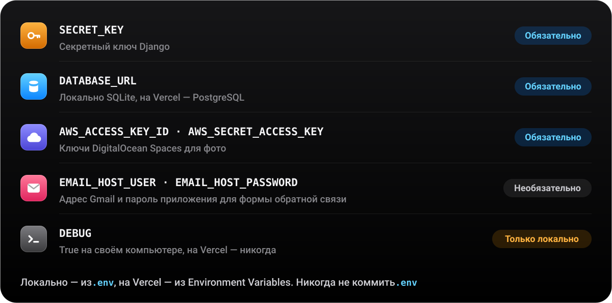

<br>
<br>

<a name="structure"></a>


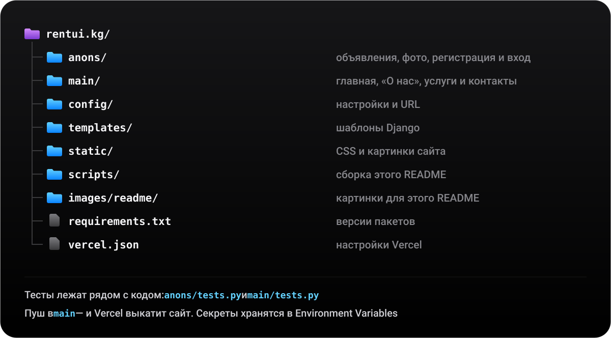

<br>
<br>


<p align="center">
  <sub>Сделано командой Fidea &nbsp;·&nbsp; <a href="https://github.com/a1tvv">@a1tvv</a> &nbsp;·&nbsp; <a href="LICENSE">Лицензия MIT</a></sub>
</p>
